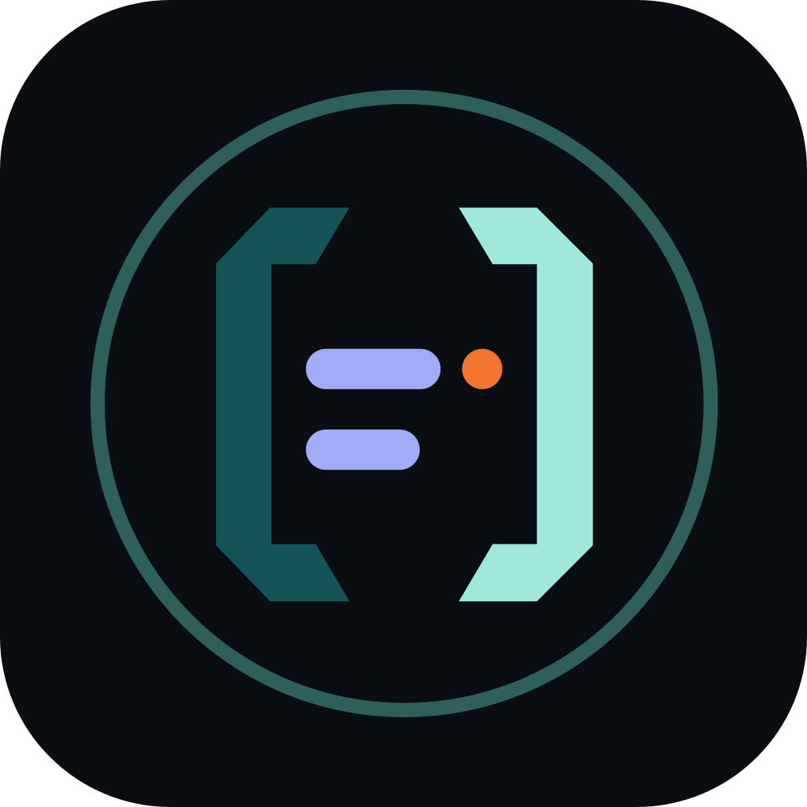

<p align="center"></p>

<h1 align="center">mnemostxt</h1>

<p align="center"><b>Just a notepad.</b> Tabs, a folder sidebar, Notepad++ keys and syntax highlighting for 140+ languages — on Linux, Windows, Android and the web.</p>

<p align="center">
  <a href="https://gitlab.com/niharokz/mnemostxt/-/pipelines"></a>
  <a href="https://gitlab.com/niharokz/mnemostxt/-/releases"></a>
  <a href="LICENSE"></a>
</p>

| Download | |
|---|---|
| Windows | [mnemostxt-setup.exe](https://gitlab.com/niharokz/mnemostxt/-/releases/permalink/latest/downloads/mnemostxt-setup.exe) |
| Linux (Debian, Ubuntu) | [mnemostxt.deb](https://gitlab.com/niharokz/mnemostxt/-/releases/permalink/latest/downloads/mnemostxt.deb) |
| Android 8+ (arm64) | [mnemostxt.apk](https://gitlab.com/niharokz/mnemostxt/-/releases/permalink/latest/downloads/mnemostxt.apk) |
| Web | run your own server — see [Web app](#web-app) |

## What it is

- **A notepad, not an IDE.** No terminal, no plugins, no extensions.
- **Tabs** for open files; **Open editors** list; middle-click closes, drag reorders.
- **Folder sidebar** with nested folders that collapse and expand. Your **notes
  folder is always there**; on the desktop you can open more folders next to
  it, or open any file on your computer (File → Open, "Open with mnemostxt",
  the command line, or drag and drop).
- **Notepad++ key bindings** (see [docs/KEYBINDINGS.md](docs/KEYBINDINGS.md)):
  Ctrl+D duplicates a line, Ctrl+L cuts it, Ctrl+Q comments, F2 bookmarks,
  Alt+drag column selection, Ctrl+click multi-cursor, Ctrl+Shift+F find in files.
- **140+ languages** highlighted, plus Caddyfile, `.env` and batch files.
- **Encodings and line endings**: UTF-8, UTF-8 BOM, UTF-16 LE/BE, ANSI; LF, CRLF, CR.
- **Markdown preview**, and a viewer for images and PDFs.
- **Never loses work.** Unsaved edits survive closing (or crashing); a file
  changed by another program or device is never overwritten silently;
  Syncthing conflict copies are flagged.
- **One setting.** Settings live in `<notes>/logs/mnemostxt/settings.json`, so the
  desktop, phone and web app look and behave the same.
- **nss look**, dark or light. The menu bar collapses into one button (Alt opens it).

## Web app

The web app edits only the notes folder, behind a sign-in.

```sh
git clone https://gitlab.com/niharokz/mnemostxt.git && cd mnemostxt
cp .env.example .env        # set NOTE_PATH, MNEMOSTXT_USER, MNEMOSTXT_PASSWORD, MNEMOSTXT_SECRET
docker network create homelab 2>/dev/null || true
docker compose up -d --build
```

Point your reverse proxy at `mnemostxt:8080` on the `homelab` network
(Caddy: `reverse_proxy mnemostxt:8080`). The home page is at `/`, the editor at
`/app/`. All settings: [.env.example](.env.example).

## Layout

```
frontend/   the editor UI (Vite + CodeMirror 6), shared by every build
app/        the Tauri 2 app: Linux, Windows and Android (Rust commands for files)
server/     the web server (Go, one static binary) with the UI built in
scripts/    version checks, release, release builds, keystore, icons
docker/     the release builder image (deb + exe + apk on one Linux machine)
assets/     logo sources
docs/       key bindings, runner set-up, releasing
```

How it fits together: [ARCHITECTURE.md](ARCHITECTURE.md).

## Develop

```sh
cd frontend && npm ci
npm run dev                    # http://localhost:5173 — in-memory demo files
npm test                       # unit tests

cd ../app && ../frontend/node_modules/.bin/tauri dev    # the desktop app (Linux needs libwebkit2gtk-4.1-dev)
cargo test

cd ../server && go test -mod=vendor ./...
```

## Build and release

A version tag builds all three installers on your own GitLab runner and
publishes a release with permanent download links:

```sh
# 1. add "## X.Y.Z - YYYY-MM-DD" to CHANGELOG.md and commit
sh scripts/release.sh X.Y.Z     # bumps every version, commits, tags, pushes
```

Build them by hand on any Linux machine with Docker:

```sh
sh scripts/make-keystore.sh     # once: the Android signing key, outside the repo
sh scripts/build-release.sh     # → dist/release/*.deb, *-setup.exe, *.apk
```

Runner set-up: [docs/RUNNER.md](docs/RUNNER.md) · Release checklist: [docs/RELEASING.md](docs/RELEASING.md)

## Licence

MIT — see [LICENSE](LICENSE). JetBrains Mono is under the SIL Open Font Licence.
